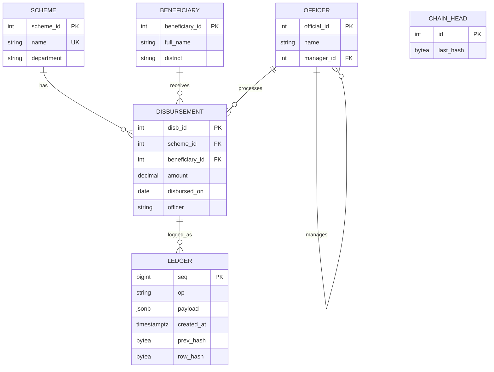

# ProofTrail: ER Diagram & Relational Mapping

## 1. Mermaid ER Diagram



---

## 2. ER-to-Relational Reduction Table

| ER Construct | Relational Table | Mapping Rule Applied |
|--------------|------------------|---------------------|
| Strong Entity: Scheme | `scheme(scheme_id PK, name, department)` | Entity → table; attributes → columns; key → PK |
| Strong Entity: Beneficiary | `beneficiary(beneficiary_id PK, full_name, district)` | Entity → table; key → PK |
| Strong Entity: Officer | `official(official_id PK, name, manager_id FK)` | Entity → table; key → PK; recursive relationship → FK to same table |
| Relationship: has (Scheme-Disbursement) | `disbursement.scheme_id FK → scheme` | 1:N → FK on N-side |
| Relationship: receives (Beneficiary-Disbursement) | `disbursement.beneficiary_id FK → beneficiary` | 1:N → FK on N-side |
| Relationship: processes (Officer-Disbursement) | `disbursement.officer` (text, not FK) | Simplified: officer as attribute |
| Relationship: manages (Officer-Officer) | `official.manager_id FK → official.official_id` | Recursive 1:N → self-referencing FK |
| Weak Entity: Ledger (depends on Disbursement) | `ledger(seq PK, disb_id in payload, ...)` | Identifying relationship → PK includes owner key; here seq is surrogate, payload carries disb_id |
| Chain Head (single-row state) | `chain_head(id=1 PK, last_hash)` | Singleton table for global chain state |

---

## 3. Relational Algebra Expressions (tied to `db/02_queries.sql`)

### RA1. Selection (σ) — Full-text search filter
**SQL (02_queries.sql:45-55):**
```sql
WHERE to_tsvector('english', s.name || ' ' || b.full_name) @@ plainto_tsquery('english', 'scholarship asha')
```
**Relational Algebra:**
```
σ_{to_tsvector(scheme.name || beneficiary.full_name) @@ 'scholarship asha'} (DISBURSEMENT ⨝ SCHEME ⨝ BENEFICIARY)
```

### RA2. Projection (π) — Public receipt view
**SQL (02_queries.sql:88-102):**
```sql
CREATE VIEW public_receipt AS
SELECT d.disb_id, s.name AS scheme, b.district, d.amount, d.disbursed_on, encode(l.row_hash, 'hex') AS ledger_hash_short
FROM ...
```
**Relational Algebra:**
```
π_{disb_id, scheme_name, district, amount, disbursed_on, ledger_hash_short} (DISBURSEMENT ⨝ SCHEME ⨝ BENEFICIARY ⨝ LATEST_LEDGER)
```

### RA3. Join (⨝) — Running total per scheme
**SQL (02_queries.sql:28-43):**
```sql
SELECT d.disb_id, d.scheme_id, s.name AS scheme_name, d.amount, d.disbursed_on,
       SUM(d.amount) OVER (PARTITION BY d.scheme_id ORDER BY d.disbursed_on, d.disb_id) AS running_total
FROM disbursement d JOIN scheme s ON s.scheme_id = d.scheme_id
```
**Relational Algebra:**
```
DISBURSEMENT ⨝_{DISBURSEMENT.scheme_id = SCHEME.scheme_id} SCHEME
```
Then window function applied (extended RA with `SUM() OVER PARTITION`)

### RA4. Set Difference (−) — Beneficiaries in scheme 1 but NOT scheme 2
**SQL (02_queries.sql:58-74) uses UNION, but EXCEPT for difference:**
```sql
-- Beneficiaries in scheme 1 EXCEPT scheme 2
SELECT b.beneficiary_id, b.full_name FROM disbursement d JOIN beneficiary b ON ...
WHERE d.scheme_id = 1
EXCEPT
SELECT b.beneficiary_id, b.full_name FROM disbursement d JOIN beneficiary b ON ...
WHERE d.scheme_id = 2
```
**Relational Algebra:**
```
π_{beneficiary_id, full_name} (σ_{scheme_id=1}(DISBURSEMENT ⨝ BENEFICIARY))
−
π_{beneficiary_id, full_name} (σ_{scheme_id=2}(DISBURSEMENT ⨝ BENEFICIARY))
```

### RA5. Aggregation (γ) — Total disbursed per scheme
**Not explicitly in 02_queries.sql but easy to add:**
```sql
SELECT s.name, SUM(d.amount) AS total_disbursed
FROM disbursement d JOIN scheme s ON s.scheme_id = d.scheme_id
GROUP BY s.name
```
**Relational Algebra:**
```
γ_{scheme_name; SUM(amount)→total_disbursed} (DISBURSEMENT ⨝ SCHEME)
```

---

## 4. Schema Summary (from `db/01_core.sql` + `db/01b_extra.sql`)

```sql
-- Core tables
CREATE TABLE scheme (
  scheme_id  serial PRIMARY KEY,
  name       text NOT NULL UNIQUE,
  department text NOT NULL
);

CREATE TABLE beneficiary (
  beneficiary_id serial PRIMARY KEY,
  full_name      text NOT NULL,
  district       text NOT NULL
);

CREATE TABLE disbursement (
  disb_id        serial PRIMARY KEY,
  scheme_id      int NOT NULL REFERENCES scheme(scheme_id),
  beneficiary_id int NOT NULL REFERENCES beneficiary(beneficiary_id),
  amount         numeric(12,2) NOT NULL CHECK (amount > 0),
  disbursed_on   date NOT NULL DEFAULT current_date,
  officer        text NOT NULL
);

-- Hierarchy table (Unit 1)
CREATE TABLE official (
  official_id serial PRIMARY KEY,
  name        text NOT NULL,
  manager_id  int REFERENCES official(official_id)
);

-- Hash-chained ledger (Unit 2)
CREATE SEQUENCE ledger_seq;
CREATE TABLE ledger (
  seq        bigint PRIMARY KEY,
  op         text NOT NULL,
  payload    jsonb NOT NULL,
  created_at timestamptz NOT NULL,
  prev_hash  bytea NOT NULL,
  row_hash   bytea NOT NULL
);
CREATE TABLE chain_head (id int PRIMARY KEY CHECK (id=1), last_hash bytea NOT NULL);
```